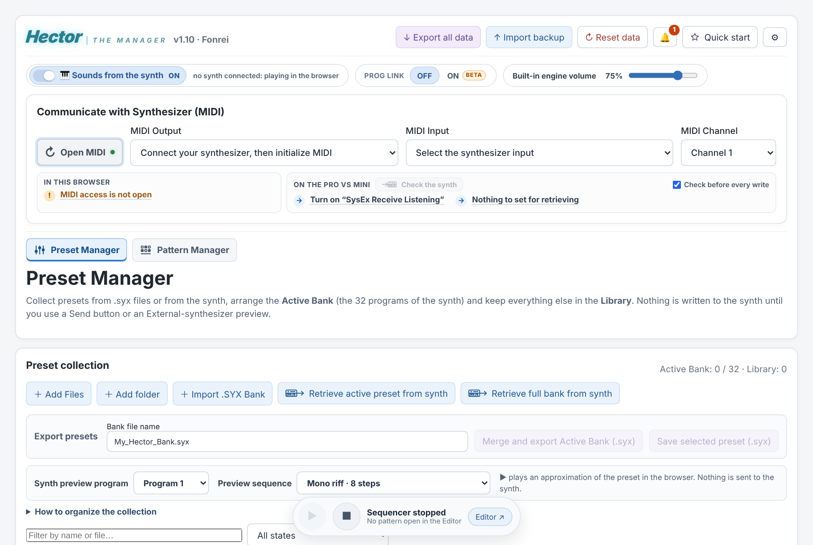
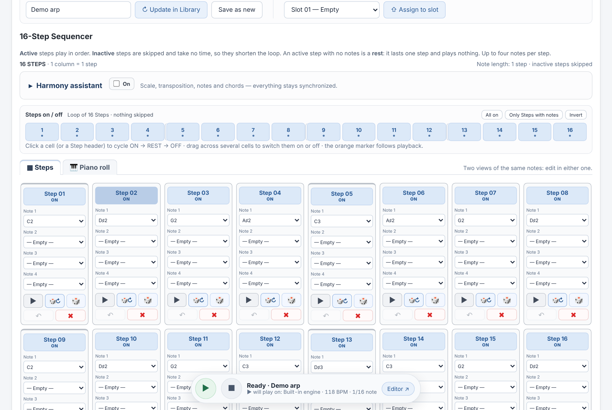

# Hector the Manager

**A free preset, pattern and sequencer manager for the Behringer Pro VS Mini in a single web page.**

No installation or accountneeded,and nothing sent to a server. Open the page in Chrome or Edge, connect your Pro VS Mini over USB, and manage its sounds and patterns from your computer.

Try it: fonrei.github.io/hector-the-manager/



## What it does

**Preset Manager**
- Collect presets from `.syx` files or read them straight from the synth (one preset or the full bank of 32).
- Arrange the Active Bank (the synth's 32 programs) and keep everything else in a Library.
- Edit presets, preview them, and write them back to the synth. Every write is read back and checked.
- Export single presets or whole banks as `.syx` files.

**Pattern Manager**
- Read and send the synth's 16 patterns.
- Edit patterns in a 16-step sequencer (up to 4 notes per step) or in a piano roll, with a harmony assistant for scales and chords.
- Import and export MIDI files.
- Play patterns in the browser, or live on the synth with CC lanes and LFOs.



## Requirements

- **Chrome or Edge** on a computer (or Chrome on Android). Firefox and Safari are not supported: they lack the Web MIDI features Hector needs.
- A **Behringer Pro VS Mini**, connected by USB. Tested with firmware 2.0.0.
- To send anything to the synth, turn on **SysEx Receive Listening** in its settings. Hector checks it for you and tells you if it is off.

## Before you start

- **Back up your synth first.** Click *Retrieve full bank from synth*, then *Merge and export Active Bank (.syx)*. Hector protects your sounds (it checks the synth before writing and reads every write back), but a backup costs ten seconds.
- **Chrome will ask for permission to "control and reprogram your MIDI devices".** This is normal: it is how a web page is allowed to send SysEx messages, which Hector uses to read and write presets and patterns.

## Privacy

Hector runs entirely in your browser. Its security policy blocks every network connection, so nothing you load or create ever leaves your computer. Your collection is stored in the browser; use *Export all data* to keep a backup file.

## How it was made

I built Hector with the help of Claude for the coding. It doesn't generate any music or sounds: it's a tool to manage your own presets and patterns. I designed it and tested everything on my own Pro VS Mini, and the code is open here for anyone to check. It also comes with an automated test suite (see below).

This program also explores features the synth was not designed for (such as previews off-bank), so consider them experimental.

## Use it offline

Download `index.html` and open it in Chrome or Edge. It works the same way with no internet connection.

## Feedback

Ideas, bugs, questions: open an [issue](../../issues). Every message is welcome.

## For developers

Hector is a single self-contained HTML file. Its Content Security Policy allows only the page's own script, identified by its SHA-256 hash: if you edit the script, run `python3 tests/update_csp.py index.html`, or the page will not start.

The `tests` folder contains an automated test suite (42 tests) that drives Hector in Chrome against a simulated Pro VS Mini. See `tests/README.fr.md` (in French) for details:

```
python3 -m pip install pytest playwright
python3 -m playwright install chromium
python3 tests/run_tests.py index.html
```

## License

Free software under the [zlib license](LICENSE).

Hector the Manager is an independent, non-commercial project. It is not affiliated with, endorsed by or connected to Behringer or Music Tribe. "Behringer" and "Pro VS Mini" are trademarks of their respective owners.
